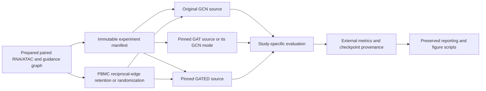

# Architecture and implementation coexistence

GLUE provides modality-specific cell encoders/decoders, graph-linked feature embeddings, graph reconstruction and adversarial alignment. The research variants change graph encoding inside that framework; they are not independently developed replacements for GLUE.

| Source role | Package and runner | Scientific distinction |
|---|---|---|
| Original GCN | [scglue/models/nn.py](scglue/models/nn.py), [encoder](scglue/models/sc.py), [runner](evaluation/workflow/scripts/run_GLUE.py) | Signed normalized prior-weight aggregation; unchanged baseline source from `38726c5` |
| Raw-prior GAT | [attention](implementations/gat/scglue/models/nn.py), [encoder](implementations/gat/scglue/models/sc.py), [runner](implementations/gat/evaluation/workflow/scripts/run_GLUE.py) | Single-head incoming-edge attention adds log(raw prior weight) to learned logits, softmax-normalizes, then aggregates signed messages |
| GATED | [convolution](implementations/gated/scglue/models/nn.py), [encoder](implementations/gated/scglue/models/sc.py), [runner](implementations/gated/evaluation/workflow/scripts/run_GLUE.py) | Independent global sigmoid logits on directed non-self edges; fixed self-loop gates; attenuation of original normalized weights without renormalization |
| GATED PBMC graph runner | [distinct runner](implementations/gated_pbmc/evaluation/workflow/scripts/run_GLUE.py), [shared perturbation utility](evaluation/workflow/scripts/graph_perturbation.py) | Retention/randomization CLI and diagnostics are preserved separately; its model package is an explicit relative symlink to the byte-identical GATED package |
| Normalized-prior GAT | [encoder](implementations/gat_normalized/scglue/models/sc.py) | Separate historical prior-normalization variant; no verified local thesis experiment design |

The gate keep penalty is the raw sum of squared `(1-gate)` values, scaled by `lam_keep`. Gates are not cell-conditioned attention, hard pruning or proof of biological importance. Graph reconstruction still targets the supplied graph weights. See the [GATED implementation note](docs/gated_glue_implementation_math.tex).

## Isolation and sharing

Each variant retains its original `scglue` import namespace. The selected implementation directory is supplied as `PYTHONPATH` and runner root by an external workspace; **do not import several variants in one Python process**. This preserves historical class/import names and prevents an unverified combined model API. No scientific package file was edited to consolidate the architectures.

Small immutable package snapshots intentionally duplicate common framework files to preserve each historical import boundary. The experiment registry, generic evaluation, graph helper and workflow templates have one canonical location. The PBMC overlay aliases an exactly matching GATED model rather than duplicating a fourth model package.

[Implementation versions](provenance/implementation_versions.json) records every package/runner digest. [Architecture fingerprints](experiments/common/architecture_sources.json) remain unchanged for the clean planner's three canonical roles. [Source routes](provenance/integration_sources.json) records every imported path and overlap decision.

## Experimental source identity

Fresh PBMC dimension rows labeled GCN select GAT's GCN mode; original-GCN graph controls explicitly require the baseline package. Reused 50D checkpoints have historical per-run source-version gaps. Current snapshot commits are reconstruction pins, not retroactive proof of how every old checkpoint was produced.

Frozen SHARE stability and PBMC control source is included, but its original absolute paths, source/job/input freezes and external evaluators are retained. Merely having all source in one tree does not make those pipelines portable or authorize bypassing their guards.

